# FDN v8.04 → v9.01 — Code Analysis

*Freight Distribution Network (Logain Industries, by Logain Abler). Analysis date: 17 Oct 2026.*
*Source: `FDN_v8.04_x/FDN_v8.03/FDN v8.04/` (31 scripts + `t/9910-L044.xml`). Comparison: FDN v7.2 (21/11/2010) and FDN Ship Equipment Patch (08/01/2011).*

All line numbers are the `linenr` values from each script's `<sourcetext>` (they match the in-game Script Editor / X-Studio line numbers and the files in `source_readable/`).

---

## 0. Headline findings

* **Size:** 31 scripts, 4,953 source lines (~46k tokens as readable text vs ~1.6 MB / ~400k tokens as raw XML). **Always feed the local AI the `source_readable/*.txt` files, never the XML.**
* **Architecture (v8):** a *DC-centric virtual network*. One player Dock is the Distribution Centre (DC). Every 25 s the AL timer runs a scheduler that (a) pulls factory products into the DC, (b) pushes primary resources from the DC into factories (buying the shortfall from NPC stations), (c) keeps docks at "maintain" levels from the DC, (d) returns surplus to the DC and (e) sells above a "sell cap". Stock that does not fit physically is held as **virtual stock** in a per-ware local variable on the station.
* **v8 vs v7.2:** v8 is a near-total rewrite. v7.2 (engine 44 = TC) used physical FDN Node/Relay/INN stations from LI_Modv7, the `plugin.LI.Dock.*` installer scripts, the Hotkey Manager and a 180 s timer. v8 (engine 50 = AP) dropped nodes, models, docks installer and hotkey; it only needs the Community Plugin Configuration menu. **v8.04 has no dependency on LI_Modv7 models**, which makes it the right base for v9 and for Farnham's Legacy.
* **Top bugs:** the factory-run lock never engages and `al.Settings[12]` is used for two different things (B1); `Update.Ware action='create'` writes to a null variable name so "Add Ware" never creates a record (B2); no ownership or DC-existence checks, so if the DC is destroyed factory products are deleted, and sold or captured stations stay managed (B3); null ware records are compared as numbers, which can trigger selling all stock (B4); the default "surplus to DC" flag is `-1`, which counts as TRUE (B5); a hard, undocumented dependency on Cycrow's Community Plugin Configuration (B6).
* **Top performance issue:** `plugin.LI.FDN.Sector.Array` scans **every player station** every 25 s, and again inside **every** Buy/Sell task. There is unbounded task fan-out (one START per factory per tick, plus one Buy task per short resource, with no locks).
* **Duplication:** 12 clusters. The biggest wins are a settings/log/ware-record library, a single menu-row builder (~28 copies), merging the DC/Dock menu pairs (70–76 % identical), and deleting the 3 TC-only menu scripts that are dead code on AP/FL.
* **Compat verdict:** **AP 3.3: yes (native target). Farnham's Legacy 1.3 (+ Unofficial Patch 1.3.20): expected to work**, because FL runs MSCI scripts and AL plugins, and Community Plugin Configuration 1.61 is published for FL. It must still be verified in-game, and a few FL-specific risks need fixing (see §7). **TC 3.4: not supported by v8.04 as shipped** (it is saved as engine 50 and uses AP-only menu commands). Treat TC as out of scope, or as a separate legacy build.

---

## 1. Script inventory
| Script | Lines (code) | Args | Purpose | Calls (START*) | al.Settings idx | Locals | Text IDs |
|---|---|---|---|---|---|---|---|
| al.LI.FDN.event | 54 (40) | al.PluginID, al.Event | AL event handler; creates settings array; timer 25 s -> Supply.Start | Setup, Supply.Start | 0,1,2,3,4,5,6,7 | - | 100 |
| al.plugin.LI.FDN.register | 9 (4) | - | AL bootstrap: load text 9910, register AL event script | - | - | - | - |
| lib.BW.isAP | 16 (7) | - | Returns TRUE if script engine >= 50 (AP/FL) | - | - | - | - |
| plugin.LI.FDN.Buy.Ware | 135 (75) | factory, ware, amount | Buys ware for a factory via a temporary docked player drone (DC pays) | Sector.Array | 1,2,7,8 | ware/fac | 4000 |
| plugin.LI.FDN.Cleanup | 33 (11) | - | Nulls FDND.* globals used by dynamic menus | - | - | - | - |
| plugin.LI.FDN.Config.Menu | 240 (156) | menu | Config view: DC select/change, auto-manage, dynamic, debug, reset | Format.Name | 1,2,6,7,9 | - | 103, 104, 105, 106, 107, 108, 109, 119 (+9) |
| plugin.LI.FDN.Format.Name | 29 (8) | object | Formats "name [ID]" (text 134) | - | 1 | - | 134 |
| plugin.LI.FDN.Main.Menu | 585 (459) | - | Menu controller (views 1,2,4,5,6,7) + command dispatcher | lib.BW.isAP, Cleanup*, Config.Menu, Menu.AP.DC.Details, Menu.AP.Dock.Details, Menu.AP.Factory.List, Menu.DC.Details, Menu.DC.Details_D*, Menu.Dock.Details, Menu.Dock.Details_D*, Menu.Factory.Details, Menu.Factory.List, Menu.Ware.Details, Move.Ware, Reset, Update.Ware | 1,2,3,5,6,7,9 | ware/fac | 102, 103, 110, 111, 112, 114, 133, 182 (+7) |
| plugin.LI.FDN.Menu.AP.DC.Details | 165 (88) | menu | AP DC view (native groupings) | Format.Name, Sort.Wares | 1,2 | - | 115, 129, 140, 142, 143, 144, 145, 164 (+8) |
| plugin.LI.FDN.Menu.AP.Dock.Details | 145 (77) | menu, value | AP dock view | Format.Name, Sort.Wares | 1 | - | 140, 143, 145, 147, 195, 196, 198, 199 (+3) |
| plugin.LI.FDN.Menu.AP.Factory.List | 250 (165) | menu | AP stations view: sectors > factories + docks; global toggles | Format.Name, Sector.Array | 1,2,9 | ware/fac | 157, 158, 159, 160, 161, 162, 163, 166 (+11) |
| plugin.LI.FDN.Menu.DC.Details | 196 (108) | menu | TC DC view (manual +/- groups) | Format.Name, Sort.Wares | 1,2 | ware/fac | 18, 19, 115, 118, 129, 140, 142, 143 (+9) |
| plugin.LI.FDN.Menu.DC.Details_D | 164 (74) | - | Background updater for DC view rows (FDND.* globals) | Wares.Summary | 0,1,2,5,6 | - | 146, 202, 5000, 5001 |
| plugin.LI.FDN.Menu.Dock.Details | 175 (94) | menu, value | TC dock view | Format.Name, Sort.Wares | 1 | ware/fac | 18, 19, 115, 140, 143, 145, 147, 195 (+4) |
| plugin.LI.FDN.Menu.Dock.Details_D | 152 (69) | value | Background updater for dock view rows | Wares.Summary | 0,1,5,6 | - | 146, 202, 5000, 5001 |
| plugin.LI.FDN.Menu.Factory.Details | 121 (96) | menu, value | Factory view: product/resource toggles | Format.Name | 1 | ware/fac | 137, 138, 139, 148, 149, 4001 |
| plugin.LI.FDN.Menu.Factory.List | 243 (167) | menu, factory.show.array | TC stations view | Format.Name, Sector.Array | 1,2,9 | ware/fac | 157, 158, 159, 160, 161, 162, 163, 166 (+10) |
| plugin.LI.FDN.Menu.Ware.Details | 313 (247) | menu, value, ware | Ware view: caps, prices, buy/sell, move, regroom, remove | Format.Name | 1,2 | ware/fac | 148, 149, 170, 171, 172, 173, 174, 175 (+10) |
| plugin.LI.FDN.Move.Ware | 154 (90) | ware, source | User transfer of ware from dock/DC to any player ship/station | Update.Ware | 1,7 | ware/fac | 178, 184, 192, 193, 194, 4000 |
| plugin.LI.FDN.Reset | 75 (37) | - | Master reset: clears FDN* locals on DC/factories/docks, empties arrays | - | 2,3,4 | ware/fac | - |
| plugin.LI.FDN.Sector.Array | 134 (75) | search | Scans all player stations; fills factory/dock arrays; returns sectors list | - | 2,3,4,8 | - | - |
| plugin.LI.FDN.Sell.Ware | 138 (81) | dock, ware, amount | Sells dock surplus via a temporary docked player drone | Sector.Array, Update.Ware | 1,7,8 | ware/fac | 4000 |
| plugin.LI.FDN.Setup | 60 (30) | - | Add/remove FDN entry in Community Plugin Config menu; resets debug log | plugin.config.addscript | 0,1 | - | 101, 102 |
| plugin.LI.FDN.Sort.Wares | 129 (82) | station | Groups tradeable wares by maintype for menus | - | - | - | - |
| plugin.LI.FDN.Supply.Dock.Check | 77 (33) | - | Loops dock array, purges dead, starts Supply.Dock (DC flag=1) | Supply.Dock* | 1,2,4,7 | - | - |
| plugin.LI.FDN.Supply.Dock | 172 (99) | dock, flag | Dock maintain levels from DC, surplus back to DC, triggers selling | Sell.Ware*, Update.Ware | 1,2 | ware/fac | 4000 |
| plugin.LI.FDN.Supply.Factory.Check | 169 (94) | - | Loops factory array, purges dead, starts Supply.Factory (product / resources) | Supply.Factory* | 1,3,7,9,12 | ware/fac | 4001 |
| plugin.LI.FDN.Supply.Factory | 151 (79) | factory, flag | Moves product to DC; supplies primary resources from DC, else buys | Buy.Ware*, Update.Ware | 1,2,7 | ware/fac | 4000 |
| plugin.LI.FDN.Supply.Start | 104 (54) | - | Per-tick scheduler: rescan stations, start factory check, dock check every 7th tick | Sector.Array*, Supply.Dock.Check*, Supply.Factory.Check* | 1,2,3,4,7,11,12 | - | - |
| plugin.LI.FDN.Update.Ware | 161 (92) | ware, amount, station, action | Core stock API: add/remove/create, physical first then virtual | - | 1 | ware/fac | 4000 |
| plugin.LI.FDN.Wares.Summary | 272 (186) | station, ware | Builds one formatted ware row for DC or dock menus; lazily creates ware record | - | 1,2 | ware/fac | 150, 151, 152, 153, 154, 155, 4000, 9000 (+1) |

"Locals" = touches station local variables (ware records `FDN.Ware.<ware>` or factory settings `FDN.Settings`). START* = launched as a separate task.

### 1.1 Entry points

| Entry | How it fires | Script |
|---|---|---|
| Game load | `al.plugin.*` scripts run on every game start/load | `al.plugin.LI.FDN.register` → `load text: id=9910`, `al engine: register script=al.LI.FDN.event` |
| AL events `init`/`reinit`/`start`/`stop` | AL engine (Gameplay → Artificial Life Settings) | `al.LI.FDN.event` → `plugin.LI.FDN.Setup` |
| AL event `timer` (every **25 s**) | AL engine | `al.LI.FDN.event` → **synchronous** call `plugin.LI.FDN.Supply.Start` |
| AL event `isenabled` | AL engine | returns `al.Settings[0]` |
| Menu | Community Plugin Configuration list, section text 101, entry text 102 → script name `'plugin.LI.FDN.Main.Menu'` (stored as a string in save games) | `plugin.LI.FDN.Main.Menu` |
| Hotkeys / ship or station commands | **none in v8.04** (v7.2 used `plugin.hotkeymanager.add`) | — |
| setup.* scripts | none | — |

### 1.2 Call graph

```mermaid
graph TD
  al_LI_FDN_event[al.LI.FDN.event] --> plugin_LI_FDN_Setup[Setup]
  al_LI_FDN_event[al.LI.FDN.event] --> plugin_LI_FDN_Supply_Start[Supply.Start]
  plugin_LI_FDN_Buy_Ware[Buy.Ware] --> plugin_LI_FDN_Sector_Array[Sector.Array]
  plugin_LI_FDN_Config_Menu[Config.Menu] --> plugin_LI_FDN_Format_Name[Format.Name]
  plugin_LI_FDN_Main_Menu[Main.Menu] --> lib_BW_isAP[lib.BW.isAP]
  plugin_LI_FDN_Main_Menu[Main.Menu] -.->|START| plugin_LI_FDN_Cleanup[Cleanup]
  plugin_LI_FDN_Main_Menu[Main.Menu] --> plugin_LI_FDN_Config_Menu[Config.Menu]
  plugin_LI_FDN_Main_Menu[Main.Menu] --> plugin_LI_FDN_Menu_AP_DC_Details[Menu.AP.DC.Details]
  plugin_LI_FDN_Main_Menu[Main.Menu] --> plugin_LI_FDN_Menu_AP_Dock_Details[Menu.AP.Dock.Details]
  plugin_LI_FDN_Main_Menu[Main.Menu] --> plugin_LI_FDN_Menu_AP_Factory_List[Menu.AP.Factory.List]
  plugin_LI_FDN_Main_Menu[Main.Menu] --> plugin_LI_FDN_Menu_DC_Details[Menu.DC.Details]
  plugin_LI_FDN_Main_Menu[Main.Menu] -.->|START| plugin_LI_FDN_Menu_DC_Details_D[Menu.DC.Details_D]
  plugin_LI_FDN_Main_Menu[Main.Menu] --> plugin_LI_FDN_Menu_Dock_Details[Menu.Dock.Details]
  plugin_LI_FDN_Main_Menu[Main.Menu] -.->|START| plugin_LI_FDN_Menu_Dock_Details_D[Menu.Dock.Details_D]
  plugin_LI_FDN_Main_Menu[Main.Menu] --> plugin_LI_FDN_Menu_Factory_Details[Menu.Factory.Details]
  plugin_LI_FDN_Main_Menu[Main.Menu] --> plugin_LI_FDN_Menu_Factory_List[Menu.Factory.List]
  plugin_LI_FDN_Main_Menu[Main.Menu] --> plugin_LI_FDN_Menu_Ware_Details[Menu.Ware.Details]
  plugin_LI_FDN_Main_Menu[Main.Menu] --> plugin_LI_FDN_Move_Ware[Move.Ware]
  plugin_LI_FDN_Main_Menu[Main.Menu] --> plugin_LI_FDN_Reset[Reset]
  plugin_LI_FDN_Main_Menu[Main.Menu] --> plugin_LI_FDN_Update_Ware[Update.Ware]
  plugin_LI_FDN_Menu_AP_DC_Details[Menu.AP.DC.Details] --> plugin_LI_FDN_Format_Name[Format.Name]
  plugin_LI_FDN_Menu_AP_DC_Details[Menu.AP.DC.Details] --> plugin_LI_FDN_Sort_Wares[Sort.Wares]
  plugin_LI_FDN_Menu_AP_Dock_Details[Menu.AP.Dock.Details] --> plugin_LI_FDN_Format_Name[Format.Name]
  plugin_LI_FDN_Menu_AP_Dock_Details[Menu.AP.Dock.Details] --> plugin_LI_FDN_Sort_Wares[Sort.Wares]
  plugin_LI_FDN_Menu_AP_Factory_List[Menu.AP.Factory.List] --> plugin_LI_FDN_Format_Name[Format.Name]
  plugin_LI_FDN_Menu_AP_Factory_List[Menu.AP.Factory.List] --> plugin_LI_FDN_Sector_Array[Sector.Array]
  plugin_LI_FDN_Menu_DC_Details[Menu.DC.Details] --> plugin_LI_FDN_Format_Name[Format.Name]
  plugin_LI_FDN_Menu_DC_Details[Menu.DC.Details] --> plugin_LI_FDN_Sort_Wares[Sort.Wares]
  plugin_LI_FDN_Menu_DC_Details_D[Menu.DC.Details_D] --> plugin_LI_FDN_Wares_Summary[Wares.Summary]
  plugin_LI_FDN_Menu_Dock_Details[Menu.Dock.Details] --> plugin_LI_FDN_Format_Name[Format.Name]
  plugin_LI_FDN_Menu_Dock_Details[Menu.Dock.Details] --> plugin_LI_FDN_Sort_Wares[Sort.Wares]
  plugin_LI_FDN_Menu_Dock_Details_D[Menu.Dock.Details_D] --> plugin_LI_FDN_Wares_Summary[Wares.Summary]
  plugin_LI_FDN_Menu_Factory_Details[Menu.Factory.Details] --> plugin_LI_FDN_Format_Name[Format.Name]
  plugin_LI_FDN_Menu_Factory_List[Menu.Factory.List] --> plugin_LI_FDN_Format_Name[Format.Name]
  plugin_LI_FDN_Menu_Factory_List[Menu.Factory.List] --> plugin_LI_FDN_Sector_Array[Sector.Array]
  plugin_LI_FDN_Menu_Ware_Details[Menu.Ware.Details] --> plugin_LI_FDN_Format_Name[Format.Name]
  plugin_LI_FDN_Move_Ware[Move.Ware] --> plugin_LI_FDN_Update_Ware[Update.Ware]
  plugin_LI_FDN_Sell_Ware[Sell.Ware] --> plugin_LI_FDN_Sector_Array[Sector.Array]
  plugin_LI_FDN_Sell_Ware[Sell.Ware] --> plugin_LI_FDN_Update_Ware[Update.Ware]
  plugin_LI_FDN_Setup[Setup] --> plugin_config_addscript[plugin.config.addscript]
  plugin_LI_FDN_Supply_Dock_Check[Supply.Dock.Check] -.->|START| plugin_LI_FDN_Supply_Dock[Supply.Dock]
  plugin_LI_FDN_Supply_Dock[Supply.Dock] -.->|START| plugin_LI_FDN_Sell_Ware[Sell.Ware]
  plugin_LI_FDN_Supply_Dock[Supply.Dock] --> plugin_LI_FDN_Update_Ware[Update.Ware]
  plugin_LI_FDN_Supply_Factory_Check[Supply.Factory.Check] -.->|START| plugin_LI_FDN_Supply_Factory[Supply.Factory]
  plugin_LI_FDN_Supply_Factory[Supply.Factory] -.->|START| plugin_LI_FDN_Buy_Ware[Buy.Ware]
  plugin_LI_FDN_Supply_Factory[Supply.Factory] --> plugin_LI_FDN_Update_Ware[Update.Ware]
  plugin_LI_FDN_Supply_Start[Supply.Start] -.->|START| plugin_LI_FDN_Sector_Array[Sector.Array]
  plugin_LI_FDN_Supply_Start[Supply.Start] -.->|START| plugin_LI_FDN_Supply_Dock_Check[Supply.Dock.Check]
  plugin_LI_FDN_Supply_Start[Supply.Start] -.->|START| plugin_LI_FDN_Supply_Factory_Check[Supply.Factory.Check]
  al_plugin_LI_FDN_register -->|registers| al_LI_FDN_event
```

Runtime fan-out per 25 s tick (worst case): `Supply.Start` → START `Sector.Array` (full scan) → START `Supply.Factory.Check` → for each factory, START `Supply.Factory` (up to twice) → START `Buy.Ware` per short resource, each of which calls `Sector.Array` (full scan + satellites) and walks every sector. Every 7th tick: START `Supply.Dock.Check` → START `Supply.Dock` per dock → START `Sell.Ware` per ware over the sell cap, each also calling `Sector.Array`.

### 1.3 Shared state (data dictionary)

**Global `al.LI.FDN.event` (array, size 30). The name is the AL plugin ID, and other scripts hard-code it.**

| Idx | Meaning | Written by | Notes |
|---|---|---|---|
| 0 | Plugin enabled | al.event | |
| 1 | Text page ID (9910) | al.event | `$DebugID = 0 + $PageID` → log file `log09910.txt` |
| 2 | DC (dock object) | Main.Menu add/change.dc | never validated (exists/owner/class) |
| 3 | Factory array | al.event, Sector.Array, Reset | purged lazily in Factory.Check |
| 4 | Dock array (includes the DC) | al.event, Sector.Array, Reset | purged lazily in Dock.Check |
| 5 | Open menu view (1 = DC, 5 = Dock …) | Main.Menu | read by the *_D updaters |
| 6 | `is.dynamic` array [0]=DC view, [1]=dock list (UI removed), [2]=dock view | al.event, Main.Menu | **B7: Dock_D reads [1], the UI toggles [2]**. Allocated size=10 (al.event L017), only [0]–[2] set (P0-A) |
| 7 | Debug on/off | Main.Menu | |
| 8 | Exclude array (all player stations) for find-station | Sector.Array | rebuilt on every scan |
| 9 | Auto-manage new factories | Main.Menu | |
| 10 | unused in v8 (used in v7.2) | — | |
| 11 | Dock-check tick counter | Supply.Start | Incremented while `< 6` (call returns early), reset to 0 at 6, then docks are supplied: skips 6 calls, runs every 7th. L071 comment "3 times" is wrong (P0-A) |
| 12 | **Collision:** "factory supply running" flag (Supply.Start) *and* "reverse array on alternate runs" toggle (Factory.Check) | both | **B1** |
| 13–29 | free | | v9 can use these (see master prompt) |

**Ware record. Station local `FDN.Ware.<ware>` (text 4000), array size 12. Created by `Update.Ware` Add.Ware.Sub and `Wares.Summary` Build.Ware.Array.Sub (duplicate code).**

| Idx | Meaning | Default | UI command |
|---|---|---|---|
| 0 | Virtual stock | 0 | to.physical / to.virtual |
| 1 | DC remote-access reserve level (DC only; >0 = sharing on) | null | remote.cap |
| 2 | Dock maintain level | null | maintain.cap |
| 3 | DC may buy this ware | FALSE | can.buy |
| 4 | Buy-at price | station price | buy.at |
| 5 | Sell-above level (−1 = off) | −1 | sell.cap |
| 6 | Sell-at price | station price | sell.at |
| 7 | Pass surplus to DC | **−1 (= TRUE!)** | surplus (toggles null/1) — **B5** |
| 8,9,11 | unused (set to null explicitly) | null | |
| 10 | unused; never set at all, null only because of `array alloc: size=12` (Update.Ware L128; P0-A) | null | |

**Factory settings. Station local `FDN.Settings` (text 4001), array size 6:** [0] manage product, [1] manage resources, [2] "already seen" flag (used to apply auto-manage once); [3..5] unused.

**Other locals:** `FDN.Show.DC` (4004) and `FDN.Show.Dock` (4003) hold the TC menu group open/closed state. 4002 and 4005 are unused.
**Dynamic-menu globals:** `FDND.Ware.<id>.<ware>` (5000), `FDND.Credits.<id>` (5001). Cleared by `plugin.LI.FDN.Cleanup` (regex `FDND.*`).

### 1.4 Text page 9910 (t/9910-L044.xml)
* 100–202: UI strings. 8–17: maintype group headers. These are used *by number*: `Sort.Wares` stores 8..17 as the group key and the menus do `read text id=$main.type`. 18/19 and 1000–1003 are TC +/- toggles; 2000–2002 are stats lines; 4000–4005 are **local-variable names**; 5000–5008 are global names; 9000–9007 are colour wrappers.
* Problems: an empty `<page id="17">` is included (pointless, and page 17 is the game's object-name page); a stray `L` after `<t id="135">`; typos (186 "Confrim", 132 "Dock LDetails"); mixed Center/Centre; English (L044) only; ids 105, 113, 115–118, 120–122, 130–133, 135–136, 156, 176, 179, 4002, 4005 and 5002–5008 are unused or empty.

---

## 2. Menu inventory

`plugin.LI.FDN.Main.Menu` is a `while [TRUE]` view controller. It rebuilds the menu each loop, calls a view script, opens it, and dispatches the return value.

| View | Title | Builder (AP / TC) | Opened with | Dynamic updater |
|---|---|---|---|---|
| 1 | Distribution Centre | `Menu.AP.DC.Details` / `Menu.DC.Details` | `open custom info menu` (maxoptions 2) | `Menu.DC.Details_D` (START each redraw) |
| 2 | Stations (sectors → factories, docks) | `Menu.AP.Factory.List` / `Menu.Factory.List` | info menu | — |
| 3 | Dock list | **removed** (dead branches remain) | | |
| 4 | Factory details | `Menu.Factory.Details` | `open custom menu` | — |
| 5 | Dock details | `Menu.AP.Dock.Details` / `Menu.Dock.Details` | info menu | `Menu.Dock.Details_D` |
| 6 | Ware details | `Menu.Ware.Details` | custom menu | — |
| 7 | Config (forced while no DC) | `Config.Menu` (ignores the `menu` arg it is passed) | custom menu | — |

**Return-value protocol:** either a string (`'switch.menu'`, `'open.config'`, `'debug'`, `'auto'`, `'dynamic.dc'`, `'dynamic.dock'`, `'dynamic.dock.list'`, `'product.all.on/off'`, `'resource.all.on/off'`, `'open.dc.menu'`, `'master.reset'`) or an array `[cmd, obj, ware]` with cmd in `remote.cap, maintain.cap, sell.cap, can.buy, surplus, buy.at, sell.at, move.ware, to.physical, to.virtual, remove.ware, add.ware, open.factory, open.dock, open.ware, add.dc, change.dc, product, resource, show.factory, show.type.dc, show.type.dock`. The AP views also return engine group commands (`create menu return value: command Open All Groups / Close All Groups`).

**Menu problems:**
1. Two parallel UI stacks (AP native groupings vs TC +/- toggles). On AP/FL, `lib.BW.isAP` is always TRUE, so `Menu.DC.Details`, `Menu.Dock.Details`, `Menu.Factory.List` and the `show.*` commands are **dead code**.
2. The header sub has branches for views 4–7 that can never run (it is only called for views 1–3). View 3 is still referenced.
3. Back navigation is hard-coded per view. View 6 returns to `$called.by`, which is unset if the view was entered by another route.
4. Row layout is hand-built about 28 times (`array alloc: size=4; [0]=1; [1]=label; [2]=-1; [3]=value`) with magic column offsets (-470, -380, -290, -200).
5. Every command that edits a value re-reads the record. If the record is null (ware never displayed), the edit is silently lost (B18).
6. Inconsistent wording and colours (Center/Centre, "Stations" vs "Factories", ON/OFF from 148/149 vs 9005/9006).
7. Opening the Stations view does a full scan plus 2 × `find station` per sector, which is slow with large empires.

---

## 3. Duplicate / near-duplicate code clusters

Method: comment and blank lines stripped, whitespace normalised, `difflib.SequenceMatcher` ratio for every script pair, plus 5-line shingles found in 3 or more scripts.

| # | Cluster | Locations | Similarity / count | v9 replacement |
|---|---|---|---|---|
| D1 | Settings fetch header (`get global variable 'al.LI.FDN.event'` + PageID/DebugID/dc…) | 26 of 31 scripts, lines ~16–35 each | 9 scripts share the identical 5-line block | `lib.LI.FDN.Cfg.Get` (returns the settings array, or null if FDN is not initialised) plus one standard 4-line header |
| D2 | `Debug.Sub` (time + script + text → log 9910) | Buy.Ware, Move.Ware, Sell.Ware, Supply.Dock.Check, Supply.Dock, Supply.Factory.Check, Supply.Factory, Supply.Start, Update.Ware | 9 identical copies (the Update.Ware copy is never called: B29) | `lib.LI.FDN.Log` (args: text, object) checks `[7]` itself |
| D3 | Ware record create (12-element default array + add/remove 1 unit trick) | Update.Ware 125–148 = Wares.Summary 247–268; `sprintf textid=4000` pointer built in 13 places | identical | `lib.LI.FDN.Ware.Rec` (station, ware, create=TRUE/FALSE) → array |
| D4 | Factory settings get-or-create + auto-manage first-seen | Supply.Factory.Check 65–84, Menu.AP.Factory.List 187–204, Menu.Factory.List (same), Menu.Factory.Details 8–14 | 3 identical + 1 variant | `lib.LI.FDN.Fac.Cfg` (factory) → array |
| D5 | 4-column menu row / ON-OFF toggle row | Config.Menu ×8, Menu.Ware.Details ×11, Menu.Factory.Details ×3, details menus ×4; ON/OFF text 148/149 ×9 | ~28 copies | `lib.LI.FDN.Menu.Row` (menu, label, value, retval) and `lib.LI.FDN.Menu.Toggle` (menu, label, bool, retval) |
| D6 | Object header line (Format.Name + get sector) | Config.Menu 42–50, AP.DC.Details 39–46, AP.Dock.Details, DC/Dock.Details, Factory.Details 16–23, Ware.Details 32–40 | 6 copies | `lib.LI.FDN.Menu.ObjLine` |
| D7 | AP vs TC menu twins and DC vs Dock twins | AP.Factory.List ≈ Factory.List **0.81**; AP.DC.Details ≈ AP.Dock.Details **0.76**; DC.Details ≈ AP.DC.Details 0.71; DC.Details ≈ Dock.Details 0.71; DC.Details_D ≈ Dock.Details_D **0.70** | 5 pairs | one `plugin.LI.FDN.Menu.Station` (mode = DC or dock), one `plugin.LI.FDN.Menu.Stations`, one `plugin.LI.FDN.Menu.Refresh`; delete the TC twins |
| D8 | Wares.Summary DC.Summary.Sub vs Dock.Summary.Sub | Wares.Summary 62–166 vs 170–241 | ~70 % | one row builder with a column spec |
| D9 | Temporary docked-drone trade (create ship → homebase → buy/sell → destruct) | Buy.Ware 66–80, Sell.Ware 74–98 | same pattern | `lib.LI.FDN.Trade` (mode, partner, ware, amount, home[, dest]): keeps the native drone trade, hardened (R-T1, REFERENCE §G) |
| D10 | "Managed factory" predicate (Factory 2006, not Complex Hub, `is detectable == 0`) | Sector.Array 59–66 and 114–123 (twice in one file), AP.Factory.List 66–75, Factory.List | 4 copies | `lib.LI.FDN.Is.Factory` |
| D11 | Main.Menu dispatcher twins | remote/maintain/sell.cap (109–141), buy.at/sell.at (131–147), to.physical/to.virtual (154–162), add.dc/change.dc (175–183), product/resource (228–246), dynamic.* (254–274), show.type.* (203–225) | 7 groups | table-driven dispatch in `plugin.LI.FDN.Menu.Command`; generic `lib.LI.FDN.Toggle` (array, idx) |
| D12 | Add.DC.Menu.Sub vs Change.DC.Menu.Sub | Config.Menu 68–97 vs 99–128 | ~95 % | one sub with an exclude-DC flag |

Expected effect: removing the 3 dead TC menus (~6.7k tokens) and the clusters above should cut the codebase by roughly 35–45 %, and leaves single places to fix bugs.

---

## 4. Bug list

Severity: **C** critical (data loss or runaway), **H** high, **M** medium, **L** low. "Verify" means the exact MSCI semantics should be confirmed in-game with a 5-line test script before relying on the fix.

| ID | Sev | Script : lines | Problem | Fix direction |
|---|---|---|---|---|
| B1 | C (**confirmed in P0-A**) | Supply.Start 55–57; Supply.Factory.Check 35–40, 153 | `$is.running = [TRUE]` sets a *local copy* and never writes `al.Settings[12]`, so the guard never engages and overlapping Factory.Check runs pile up whenever one run takes longer than 25 s (300+ factories × 100–200 ms waits plus supply). Factory.Check also uses `[12]` as its reverse-order toggle and clears it at the end. | Split into `[12]` run-lock (store `playing time` and treat it as stale after N s) and `[13]` reverse toggle. Set the lock with `$al.Settings[12] = …`. Release it in every exit path. |
| B2 | H (**confirmed in P0-A**) | Update.Ware 33–35 (+ Add.Ware.Sub 125–140); callers Main.Menu 475, Supply.Dock 100 | `action='create'` jumps to Add.Ware.Sub before `$pointer` is assigned (only set at line 46), so the record is written under a **null name**. Result: "Add Ware" never creates settings, and Supply.Dock's create-then-read returns null. | Build `$pointer` before any gosub, or replace with `lib.LI.FDN.Ware.Rec(create)`. |
| B3 | C (**confirmed in P0-B**) | Supply.Start 46; Supply.Factory 67–72, 107, 129; Supply.Factory.Check 63; Supply.Dock.Check 39/47; Main.Menu 51 | Only `if $dc` / `-> exists` are checked (Supply.Start L046 is just `if $dc`). (a) If the DC is destroyed: Supply.Factory L067 calls Update.Ware 'add' on the DC, but Update.Ware only handles stock when the station `is of class Dock` (L043), so for a dead DC it does nothing and returns 0; L071–072 then remove the product from the factory anyway, so **wares vanish**. Supply.Factory L107 ('remove' from the DC) and L129 (reads the DC's ware record) also act on `$dc` unchecked. (b) No station-management script checks ownership: the only `owner` in the code is the `owner=Player` argument of the drone `create ship` in Buy.Ware/Sell.Ware. Sold, captured or given-away stations stay in the arrays and keep being supplied and drained. | Validate the DC once per tick (`exists`, `get owner race == Player`, `is of class Dock`). On failure, pause FDN and notify the player. Remove from the factory only what Update.Ware reports as added. Add an owner check in both Check loops and drop non-player stations from the arrays. |
| B4 | H (**partly confirmed in P0-B**; depends on test C1 T1) | Supply.Dock 145–158 (Sell.Ware.Sub); Sell.Ware 44–49 (and 36–37, same exposure) | If a ware has no record, `$sell = null`; if `null >= 0` is TRUE in MSCI (null behaves as 0, to be tested), Sell.Ware computes `amount = stock - null = stock` and **sells the whole stock**. Records are not only created by the menus: Update.Ware's 'add' path creates one (L052 `gosub Add.Ware.Sub`) when stock is added to a dock with no record. But the explicit `action='create'` calls (Supply.Dock L100, Main.Menu L475) do nothing because of **B2**, so the DC record that Supply.Dock L098–102 thinks it just created can still be missing. | Skip when the record is null; treat the sell cap as active only if `is datatyp == DATATYPE_INT` and `>= 0`. Fixing B2 also closes the Supply.Dock L098–102 gap. |
| B5 | M/H | Update.Ware 136; Wares.Summary 257; Supply.Dock 84–91 | The default `[7] = -1` is TRUE in MSCI, so "pass surplus to DC" is ON for every new ware. With maintain level null (→ 0), the **entire stock of every non-DC dock is pulled into the DC** every dock cycle. The menu shows "ON", so this may be intended, but it is surprising and undocumented. | **Decided by Matt (2026-10-17): make it configurable.** New global default `[28]` (1 on, 0 off, 2 v8 compatible) for wares whose `[7]` is −1/null; per-ware `[7]` is an explicit override (1 on, 0 off, −1/null use default). Config menu row (texts 320–325). v8 upgrade sets `[28]` = 1 and migrates v8 records' `[7]` null → 0 (in v8 null meant the player switched it off; migration approved by Matt 2026-10-17; fresh installs also default to `[28]` = 1), so existing saves behave exactly as before. Implemented in Phase 3 (menus) and Phase 4 (engine + upgrade, card P4-04b). |
| B6 | H | Setup 36–38, 42–53 | Hard dependency on `plugin.config.addscript` (Cycrow's Community Plugin Configuration, a separate download, not part of the game or the Egosoft bonus pack). Without it FDN has no menu. Stop/uninstall removes the entry by matching display text against the library's internal array (`config.scripts[i][0]`), which is fragile. | Check that the script is available before calling it. Add a native hotkey (`register hotkey … to call script`) as a fallback. Use the library's own remove function if one exists, otherwise keep the current approach but guard it. |
| B7 | M (**confirmed in P0-B**) | Menu.Dock.Details_D 26 | The dock updater reads `$al.Settings[6][1]`, but the Config "Dock Details Menu" toggle (Config.Menu L172) and Main.Menu's `dynamic.dock` handler (L261–266) both use `[6][2]`, so the toggle does nothing. `dynamic.dock.list` (Main.Menu L268–274) toggles `[1]` for the removed dock-list UI (its Config row L151–164 is commented out); it is not swapped with `dynamic.dock`. | **One line:** Menu.Dock.Details_D L026 reads `[6][2]`. Nothing else changes. |
| B8 | M | Main.Menu 413, 446; DC.Details_D 33–44; Dock.Details_D | (a) A new `_D` updater task is STARTed on **every menu redraw** (every click), so updaters stack up. (b) The view reads `FDND.*` globals right after START; the updater may not have written them yet, which gives empty rows on first draw (verify). (c) DC_D runs Write.Menu.Global before its `if $dc` check. | One refresh task with a lock/token in settings. Build the rows synchronously for the first draw, and refresh only while the token matches. |
| B9 | M (**confirmed in P0-B**) | Reset 28–30, 43–48, 64 | L064 regex `'FDN*'` means "FD followed by any number of N", so it matches **any** variable containing "FD", including other mods' locals. L028–030: no null/exists check on the DC. Reset never pauses FDN (enable flag `[0]`), so running supply tasks carry on. L043–048 only clear docks still in the dock array, so docks that have left it (for example a former DC) keep their `FDN.Ware.*` locals. | **Decided by Matt (2026-10-17):** Reset clears FDN locals on every station FDN manages or has managed. New registry `[29]` (every station ever added as DC/factory/dock or given an `FDN.Ware.*` record; appended via `lib.LI.FDN.Reg.Add`, pruned at Reset/Upgrade, seeded from `[2]`/`[3]`/`[4]` on upgrade). Reset: set `[0]` FALSE first, walk `[29]` + `[2]` + `[3]` + `[4]`, skip stations that don't exist, clear with `'^FDN\.'` if test T8 passes, otherwise an exact-prefix loop (only names starting `FDN.`). Then empty the arrays and `[29]`. |
| B10 | M | Sector.Array 7–10, 84; callers Supply.Start 37 (search=4), Menu.AP.Factory.List 15 (search=4), Buy/Sell (3) | The documented modes 1/2/3 are ignored except for 3. Callers pass 4. The function both *scans* (mutating settings [3]/[4]/[8]) and *returns a list*, two jobs in one. | Split into `plugin.LI.FDN.Scan` (refresh caches, rate-limited) and `lib.LI.FDN.Sectors` (read-only, uses the cache). |
| B11 | M | Supply.Factory 128–133; Supply.Dock 155 | Buy.Ware and Sell.Ware are STARTed every cycle with no per-station/ware lock, so the same shortfall can be bought several times, and sells overlap. | Per-station local lock `FDN.Busy.<ware>` (or a settings table), cleared by the task and stale after a timeout. |
| B12 | M | Supply.Dock 37–45, 56–137; Sell.Ware 41–124; Buy.Ware 49–111 | Loops `wait` but never re-check that the dock, factory or DC still exists or is player-owned after the wait. | Re-validate after each wait (`lib.LI.FDN.Is.Valid`). |
| B13 | M (verify) | Supply.Factory.Check 38 | `reverse array` may return a new array. If so, on reversed passes the "remove destroyed factory" edits go to the copy, and the stored array is never purged on those passes. | Iterate by index direction instead of reversing; purge on the stored array only. |
| B14 | M | al.LI.FDN.event 45; Supply.Start 38 | The timer handler calls Supply.Start **synchronously**, and Supply.Start contains `wait 1000 ms`, so the AL event dispatch blocks for at least 1 s per tick (verify the AL engine's behaviour). | `START` the scheduler. Keep AL event handlers wait-free. |
| B15 | M | Sell.Ware 74–98; Buy.Ware 74–80 | The per-trade player "Argon Mercury Super Freighter XL" drone is fragile: (a) no check that `create ship` succeeded (a null drone means buy/sell/destruct on null); (b) the ship type is compiled as a type index, which can differ under XRM or other TShips mods; (c) no docking, transport-class, price, money or partner-stock checks before spawning; (d) Buy.Ware doesn't clamp to the drone's cargo; (e) destroying it may fire SIGNAL_KILLED handlers (VERIFY); (f) no cap or guard, so overlapping tasks spawn drones for the same ware (B11). | **Keep the mechanism** (decision R-T1, see §4.1) and harden it in `lib.LI.FDN.Trade` (REFERENCE §G). Phase 1: null-check the drone and destruct it on every path. |
| B16 | M | al.LI.FDN.event 7–24 | The settings schema is not versioned. A v7.2 save already has an `al.LI.FDN.event` array with a **different layout** (v7 used idx 0–11 differently, including [10]), and v8 reuses it unchanged. | Add `[14] = schema version (901)` and a `plugin.LI.FDN.Upgrade` migration run on init/reinit. |
| B17 | L | Sort.Wares 49–73 | Wares whose maintype is not in the 9 listed groups are silently dropped from menus. | Add an "Other" group. |
| B18 | L | Main.Menu 338–407 | If the ware record is null, the edits are applied to a null array and lost. | Get-or-create through `lib.LI.FDN.Ware.Rec`. |
| B19 | L | Main.Menu 467–478 | Add Ware: if the user cancels, `$ware` is null and the code proceeds anyway. Also affected by B2. | Null check. |
| B20 | L | Move.Ware 52–67 | If the destination prompt is cancelled (null), it is not handled before the `-> is of class` / `get free amount` calls. | Null check. |
| B21 | L | Menu.Ware.Details 38, 52–53 | Shows the **DC's** sector for any station. The line 52 sprintf result is immediately overwritten. | Use `$value -> get sector`. Delete the dead line. |
| B22 | L | Menu.Factory.Details 8 | `sprintf textid=4001, $value` on a string with no `%s` works by accident. | `read text`. |
| B23 | L | Config.Menu 28 | Ignores the `menu` argument (creates its own). | Use the passed menu (or drop the argument). |
| B24 | L | Main.Menu 47, 92, 540–560 | Dead view-3 branches and unreachable header branches. | Delete. |
| B25 | L | Sector.Array 69–72 vs 125–128 | Docks are appended twice (the sub plus the main loop); `find in array` is O(n²). | Single pass. |
| B26 | L | Main.Menu 507–511 | Remove Ware deletes the record (and any virtual stock) without confirmation. The UI only offers it at stock 0 in Ware.Details, but the command path does not re-check. | Re-check stock == 0. |
| B27 | L | t/9910-L044.xml | Empty page 17, stray `L`, typos, English only. | Clean up; add L049 (German) etc. as copies. |
| B28 | L | Format.Name 16–19; others | Scripts continue with `$PageID` null if settings are missing (some return, some do not). | The standard header returns null. |
| B29 | L | Update.Ware 151–157 | `Debug.Sub:` (label at L152) is dead code: no `gosub Debug.Sub:` anywhere in the file, and Update.Ware never reads settings `[7]`, so it never logs (found in P0-A). | Phase 2: delete it when Update.Ware switches to `lib.LI.FDN.Log` (task P2-12a), and add log calls at its decision points. |

**Verification status (Phase 0):** B1 and B2 confirmed in P0-A (`notes/P0-A_findings.md`). B3, B7 and B9 confirmed, B4 partly confirmed (waits on test C1 T1) in P0-B (`notes/P0-B_findings.md`). All checked by X Mod Bot on 2026-10-17. B5, B6, B8 and B10–B29 have not been re-checked line by line yet.

### 4.1 Why FDN trades through a temporary drone (decision R-T1: keep it)
X3 MSCI has no command for one station to trade with another. Only a ship docked at a station can `buy`/`sell`, so FDN creates a player ship already docked at the NPC station, sets its homebase to the DC or dock (that account pays or receives), trades, and destroys it in the same wait-free block. The game therefore applies the real price, moves the money and changes the NPC stock, and the trade may also count towards trade rank and statistics (Phase 0 E checks this). The drone never flies, so nothing visible is lost or gained either way. Matt's decision: keep it, and make it robust (REFERENCE §G). Direct transfer remains only a possible future config option.

---

## 5. Performance issues

| ID | Where | Issue | Suggested fix |
|---|---|---|---|
| P1 | Supply.Start 37 → Sector.Array 43 | `get station array: of race Player class/type=Station` + O(n²) `find in array` **every 25 s** | Rate-limit the scan (e.g. every 5 min, or when the menu opens). Keep `[15]` sector cache + `[16]` timestamp. |
| P2 | Buy.Ware 44, Sell.Ware 34 → Sector.Array (search=3, also scans all player satellites) | One full scan **per Buy/Sell task** | Use the cache; never scan inside a trade task |
| P3 | Buy.Ware 49–111, Sell.Ware 41–124 | Walks every player sector with `find station … max.jumps=0`, waiting 0.3–1 s each, so tasks live for minutes and overlap | Use `max.jumps=N` from the DC sector once (one call), or the sector cache in batches. Cap concurrent trade tasks (counter in settings). |
| P4 | Supply.Factory.Check 96/122/133 | One START per factory (up to 2) per tick | Process factories inline in one task (call, not START), with a per-tick budget (e.g. 40 factories per tick, cursor in `[17]`) |
| P5 | Main.Menu 413/446 + *_D | Stacked refresh loops calling Wares.Summary for every ware every 1–5 s | One refresh task; refresh only the visible group, or only on a timer when dynamic is ON |
| P6 | Menu.AP.Factory.List 15, 56, 83 | Full scan plus 2 × `find station maxnum=999` per sector on every open | Build from the cached factory/dock arrays grouped by sector |
| P7 | Supply.Factory.Check 65, Main.Menu 519, Setup 49 | Loop-invariant `read text` inside loops | Hoist |
| P8 | Supply.Dock 56–137 | No wait per ware for normal docks (one wait after the loop); large docks run in one frame | Wait every N wares |

---

## 6. v7.2 → v8.04 differences that matter for v9

| Topic | v7.2 (Nov 2010) | v8.04 (Aug 2012) | Consequence for v9 |
|---|---|---|---|
| Engine | 44 (TC) | 50 (AP) | v8 scripts need AP or newer; FL loads older-engine scripts |
| Network model | Physical FDN Nodes/Relays/INN (LI_Modv7 station types, text 300038…) | Single DC + virtual stock | No model dependency. Keep it that way. |
| Scripts | 46 (incl. `plugin.LI.Dock.Installer/Replace/Check/Remover`, `Settings`, `Node.*`, `Relay.*`, `*.Task`) | 31 | Old saves may still hold v7 tasks/locals → the upgrade must tolerate them |
| Menus | Hotkey Manager + config | Config menu only | Re-add an optional hotkey (B6) |
| Timer | 180 s | 25 s | 25 s plus a full scan is too aggressive (P1) |
| Settings layout | idx 0–11, incl. 10 | idx 0–12 (10 unused) | Schema version needed (B16) |
| PM integration | `plugin.LI.PM.Ware.Menu` called from Ware.Menu | none | A PM link could return later as an optional hook |
| Ship Equipment Patch (Jan 2011) | patched `Main.Ware`/`Node.Menu` (v7 only) | n/a | Not applicable to v8/v9 |

---

## 7. X3 version and mod compatibility matrix

| Target | Latest version (verified) | Script engine | FDN v8.04 today | v9.01 plan |
|---|---|---|---|---|
| X3: Terran Conflict | **3.4** (07 Dec 2017) [S1] | ~44 (v7.2 is saved as 44; BW's note in `lib.BW.isAP`: "TC 3.2 = 44") | **Not supported**: scripts saved at engine 50 and use AP-only commands (`add new grouping to menu`, `create menu return value: command …`) | Out of scope (keep v7.2 for TC). Optionally a "TC" build later. |
| X3: Albion Prelude | **3.3** (final, Dec 2017; released with TC 3.4) [S2] | ≥ 50 (v8.04 saved at 50; BW: "AP 2.0 = 52") | Native | **Primary target** |
| X3: Farnham's Legacy | Official **1.3**; Steam public build 16 Feb 2024 [S3]. Community **Unofficial Patch 1.3.20** (21 Mar 2026, Cycrow) [S4][S5] | FL patch scripts carry `<engineversion>` 60–74 (checked in Cycrow's X3FLPatch repo) [S5] | Expected to work: FL supports MSCI scripts and AL plugins, and scripts run in existing saves [S6]. `lib.BW.isAP` (≥ 50) returns TRUE in FL, so AP menus are used. **Not yet verified in-game.** | **Primary target.** Install to `addon2\scripts`, `addon2\t` |
| Plugin Manager (Cycrow) | **1.92** (forum 31 Jan 2026; site updated 19 May 2026); supports TC/AP/FL [S7][S8] | — | v7.2 shipped as .spk | Package v9.01 as .spk with TC/AP/FL compatibility flags (AP + FL ticked) |
| Community Plugin Configuration (Cycrow) | **1.61** (27 Aug 2023), listed for TC/AP/FL games 3/4/5 [S9] | — | Required (B6) | Optional: use if present, otherwise hotkey |
| Hotkey Manager (Cycrow) | 1.21 (03 Jan 2012), listed for 3/4/5 [S9] | — | not used in v8 | Optional |
| Egosoft AP Bonus Pack | 5.1.0 (20 Dec 2011) [S10] | — | Does **not** contain the config menu | Note that Dockware Manager (in the bonus pack) also edits dock wares, so there is a conflict risk |
| XRM (TC/AP total conversion) | v1.30d (02.12.13) [S11] | — | Mostly OK. FDN reads wares dynamically. Risk: compiled ship type in Buy/Sell (B15), changed prices, and XRM's own logistics | Keep the drone trade, but resolve the drone type at runtime (`[25]`/`[26]`, REFERENCE §G) and check prices against min/max; no hard-coded wares |
| Litcube's Universe (AP) | — | — | **Not supported by LU**: "Plugin Manager is not compatible … Do not install the Bonus Pack … LU only supports LUV installs" [S12] | Document as unsupported; the hotkey fallback lets brave users try |
| SRM / other ware-rebalance mods | not researched in depth | — | FDN uses no hard-coded ware indices; the drone ship type becomes configurable and runtime-checked | Same as XRM |

**FL-specific gotchas:**
1. Folder is `addon2` (AP = `addon`). The Plugin Manager must have the FL game selected [S13].
2. Text files use `XXXX-L044.xml` (FL patch uses `0001-L044.xml`), so `9910-L044.xml` is fine. FL ships extra languages (German L049, Russian L007), so add copies to avoid ReadText errors.
3. FL has native Station Manager and Trade Distribution commands that also move dock and factory wares. **Decided by Matt (2026-10-17):** stations run by Station Manager are dropped from the FDN network (removed from `[3]`/`[4]`; if it is the DC, FDN pauses), with a player message and a log line. Detection goes through `lib.LI.FDN.Is.FL.Managed` (FL only, via `lib.LI.FDN.Game`); the exact command is VERIFY (test T9). The check runs in Scan next to the exists/owner checks. See REFERENCE §H.
4. The Unofficial Patch adds new script commands (e.g. `add script selection option`, `add sidebar custom entry`, `get dock storage wares`, `add object info menu`) [S5]. These are **only** available with the patch, so use them behind a feature check, never as hard requirements.
5. The FL patch "Fixed script engine version (increased)" [S5], so version thresholds in `lib.BW.isAP` must use `>=`, never `==`. Log the actual `script engine version` in each game install to confirm.
6. Compiling: XScript (Cycrow) compiles to FL-format XML using the FL command database `x3fl.xml` [S14]. Output compiled for FL may carry an FL engine version, so do not assume it loads in AP. X-Studio 1.08 (Feb 2014) supports X2/X3R/TC/AP but predates FL [S15].

**Text page and naming registry:** the Egosoft registries are forum threads (TC: t=216690, FL index: t=436924) [S16]. The rule is that text file IDs 7000–9999 implicitly reserve the matching page. FDN/LI use 9910–9915, so Matt should confirm or register them in the FL thread. (The forum blocks automated reading, so I could not confirm whether 9910 is listed.)

### Sources
* [S1] Egosoft, X3TC patches: http://egosoft.com/download/x3tc/patches_en.php (TC 3.4, 07.Dec.17), verified.
* [S2] AP 3.3 final alongside TC 3.4: Egosoft forum announcement https://forum.egosoft.com/viewtopic.php?p=4692254 (search result; the forum blocks automated fetch).
* [S3] SteamDB FL depots, public build 13476652, 16 Feb 2024: https://steamdb.info/app/483330/depots/ (via search).
* [S4] Unofficial Patch thread, V1.3.20 2026-03-21: https://forum.egosoft.com/viewtopic.php?t=448962 (via search).
* [S5] Cycrow X3FLPatch repo (latest release 1.3.20, 30 Mar 2026), cloned and inspected for engine versions: https://github.com/Cycrowuk/X3FLPatch/. Patch feature list: https://www.xpluginmanager.co.uk/addons/x3-farnhams-legacy-addons/x3fl-unoffical-patch/ (verified).
* [S6] Egosoft forum, FL modding Q&A ("for just scripts, these will run fine in existing games"): https://forum.egosoft.com/viewtopic.php?f=94&t=446197 (via search).
* [S7] Plugin Manager download page, v1.92: https://www.xpluginmanager.co.uk/download/x-plugin-manager-installer/ (via search).
* [S8] Plugin Manager home (supports Reunion, TC, AP, FL): https://www.xpluginmanager.co.uk/ (via search).
* [S9] Plugin Manager package index for FL: https://xpluginmanager.co.uk/flscripts/xpackagedata.dat (downloaded; lists Community Plugin Configuration 1.61, Hotkey Manager 1.21, Cycrow Libraries 1.12, Plugin Manager Library Scripts FL 1.11).
* [S10] Egosoft AP bonus material (All-in-One Bonus Package v5.1.0, 20.Dec.11): https://www.egosoft.com/download/x3ap/bonus_en.php (verified).
* [S11] XRM thread: https://forum.egosoft.com/viewtopic.php?t=304158.
* [S12] LU FAQ "Common Known compatibility issues": https://robunderscore.github.io/litcube/litcube.xtimelines.net/wiki/index.php/FAQ.html (verified).
* [S13] Cycrow on Steam forums (select the FL "addon2" directory in the Plugin Manager): https://steamcommunity.com/app/483330/discussions/0/3053985636027093819/ (via search).
* [S14] XScript Compiler 0.8 beta (compile/decompile, VS Code extension): https://www.xpluginmanager.co.uk/xscript/ (verified).
* [S15] X-Studio 1.08 (14 Feb 2014) for X2/X3R/TC/AP: https://xdownloads.co.uk/index.php?Itemid=116&catid=7&id=1796%3Ax-studio&option=com_jdownloads&view=download (verified). Source repo: https://github.com/nick-crowley/X-Studio.
* [S16] FL Community Script & Mod Library / text ID registry: https://forum.egosoft.com/viewtopic.php?t=436924. TC t-file rules: https://forum.egosoft.com/viewtopic.php?t=229421 (via search).
* [S17] MSCI handbook (X², still the best syntax primer): https://xfiles.chaos.net.nz/MSCIHandbook.pdf (verified, 2.6 MB PDF). X3R command list: http://xpluginmanager.co.uk/scripts/help/cmds.html (verified; pre-TC, so it lacks TC/AP commands such as arrays-sort/reverse, custom menus and groupings).

---

## 8. Editing workflow constraint (why the AI must not touch the XML)

Each script XML holds `<sourcetext>` (display only) **and** `<codearray>` (what the game executes). Editing `<sourcetext>` by hand does nothing in-game, and editing `<codearray>` by hand breaks the script. Valid ways to produce a new XML:
1. **In-game Script Editor** (pilot name `Thereshallbewings`; Shift+C → Script Editor). Always works, but is slow to type.
2. **X-Studio 1.08** (TC/AP): opens the XML, edits text, compiles a new XML. Best for AP.
3. **XScript Compiler 0.8 beta** (Cycrow, FL): `--decompile` XML → `.xs`, edit in VS Code (official extension), `--compile` → XML. This is the only fully text-based, AI-friendly pipeline. It targets FL's command DB; validate the round-trip first (Phase 0).
4. Exscriptor (it produced the v8.04 files, per their header): obsolete, links dead.

The prompts therefore have the AI produce **readable MSCI source** (the same format as `source_readable/*.txt`), or `.xs` if the XScript round-trip passes. Matt compiles with the tool.
